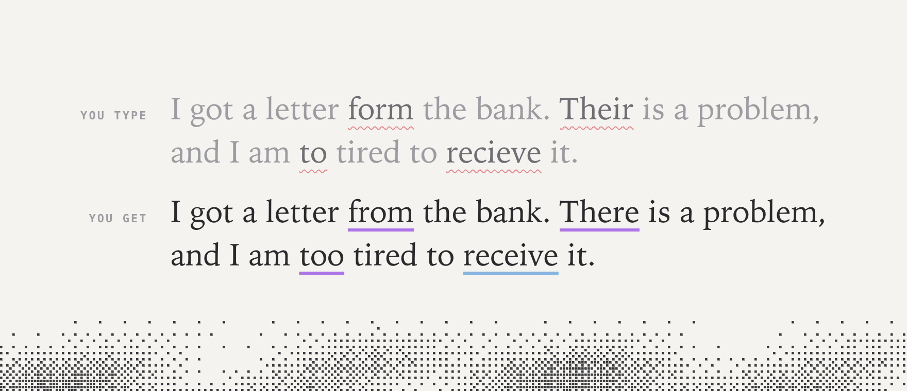

<p align="center">
  
</p>

Spell check can't tell that “form” was meant to be “from”, since both are real words. tinyfix can. It's a 2 MB model that reads the words on both sides of each word, and it runs in the browser, so nothing anyone types leaves the page.

```bash
npm install tinyfix
```

```ts
import { loadTinyfix } from "tinyfix";

const tinyfix = await loadTinyfix();

await tinyfix.fix("I got a letter form the bank and did not recieve it.");
// "I got a letter from the bank and did not receive it."
```

<p align="center">
  
</p>

It's the autocorrect in [offlinepage.app](https://offlinepage.app), a writing app that works in airplane mode.

## Getting the fixes

`check` returns what it would change and where, so you can show it your own way: underline it, ask first, or apply it.

```ts
const text = "I got a letter form the bank and did not recieve it.";
const fixes = await tinyfix.check(text);
// [
//   { from: 15, to: 19, original: "form",    replacement: "from",    kind: "context",  confidence: 1 },
//   { from: 41, to: 48, original: "recieve", replacement: "receive", kind: "spelling", confidence: 0.95 },
// ]

tinyfix.apply(text, fixes);
// "I got a letter from the bank and did not receive it."
```

A fix is one of two kinds:

- `"spelling"`: the word isn't a word. “recieve” becomes “receive”.
- `"context"`: the word is real but doesn't fit the words around it. “form” becomes “from”.

## API

| Call                            | What it does                                                             |
| ------------------------------- | ------------------------------------------------------------------------ |
| `loadTinyfix(options?)`         | Downloads the model and word lists, and returns a checker. Call it once. |
| `tinyfix.check(text, options?)` | Returns the fixes for a text, in order. They never overlap.              |
| `tinyfix.apply(text, fixes)`    | Returns the text with those fixes made.                                  |
| `tinyfix.fix(text, options?)`   | `check`, then `apply`.                                                   |
| `tinyfix.ignore(word)`          | Never change this word again.                                            |
| `tinyfix.dispose()`             | Frees the model.                                                         |

### `loadTinyfix` options

| Option      | Default                                                                      | What it does                                                                               |
| ----------- | ---------------------------------------------------------------------------- | ------------------------------------------------------------------------------------------ |
| `baseUrl`   | The [model repo](https://huggingface.co/paperweight/tinyfix) on Hugging Face | Where the four model files are, if you host them yourself                                  |
| `model`     | `true`                                                                       | `false` skips the model. Only the word list is downloaded and only misspellings are fixed. |
| `mode`      | `"balanced"`                                                                 | `"careful"` makes fewer wrong changes and fixes fewer wrong words                          |
| `wasmPaths` | Found by your bundler                                                        | Where ONNX Runtime's `.wasm` files are, if you host those too                              |

### `check` options

| Option  | What it does                                                                                   |
| ------- | ---------------------------------------------------------------------------------------------- |
| `range` | `[from, to]`. Only words inside it are checked; the rest of the text is still read as context. |
| `kinds` | `["spelling"]`, `["context"]` or both. Both by default.                                        |

## Fixing as someone types

`check` treats the text as finished writing. To fix while someone types, check one word at a time with `range`, so you never re-check the whole page on a keystroke. offlinepage.app does this:

```ts
// When a word is finished: is it misspelled?
await tinyfix.check(paragraph, { range: [wordStart, wordEnd], kinds: ["spelling"] });

// Two words later, when it has words on both sides: is it the wrong word?
await tinyfix.check(paragraph, { range: [earlierStart, earlierEnd], kinds: ["context"] });
```

When someone undoes a fix, call `tinyfix.ignore(fix.original)` so it doesn't come back.

## How well it works

<table>
  <tr>
    <td align="center" width="33%"><h3>94%</h3>of its fixes are right</td>
    <td align="center" width="33%"><h3>40%</h3>of wrong words fixed</td>
    <td align="center" width="33%"><h3>under 1 ms</h3>per word</td>
  </tr>
</table>

On about 110,000 words of correct writing it wrongly changed about 1 word in 2,000. It would rather leave a typo alone than change a word you meant, so it misses more wrong words than it catches. The [model card](https://huggingface.co/paperweight/tinyfix) has the test sets, what it misses and how it was trained.

## What it leaves alone

- Code in backticks, inline or fenced
- Web addresses, emails, file paths, `#tags` and words with digits
- Names, and words in ALL CAPS
- Anything you pass to `ignore`

A line break counts as the end of a sentence. Positions are JavaScript string indexes.

## What it downloads

About 3.5 MB the first time, from Hugging Face: the 2.1 MB model, its 20,000-word vocabulary, a list of words people mix up, and an 80,000-word spelling list. Each version of this package loads one exact revision of those files, so it always behaves the same.

To serve them from your own site, copy the four files from the [model repo](https://huggingface.co/paperweight/tinyfix/tree/main) (`wrong-word.onnx`, `wrong-word-vocab.txt`, `wrong-word-confusions.txt`, `words.txt`) and point `baseUrl` at the folder:

```ts
const tinyfix = await loadTinyfix({ baseUrl: "/models/" });
```

The model runs on [ONNX Runtime Web](https://onnxruntime.ai/docs/tutorials/web/), which is installed with this package. On a page it runs in ONNX Runtime's own worker, so loading it doesn't freeze typing.

## Where it runs

Browsers, Web Workers and Node 18 or later. English only.

## Development

```bash
npm test         # downloads the model files once, then runs the tests
npm run check    # types
npm run lint
```

## License

MIT, for this package and for the model.
